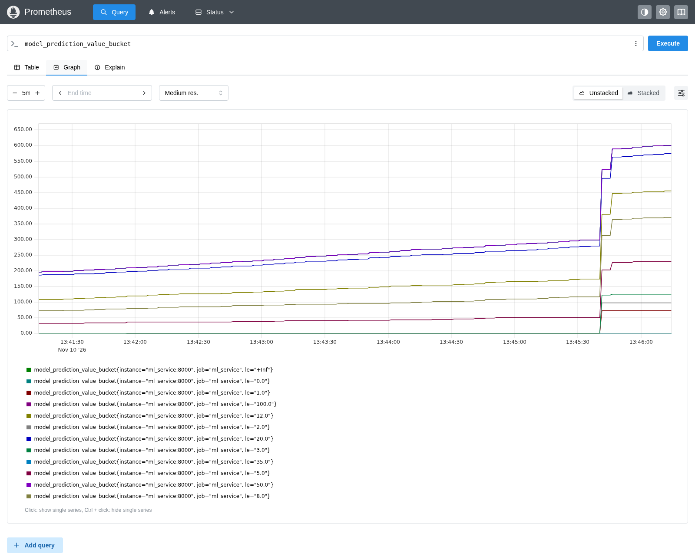
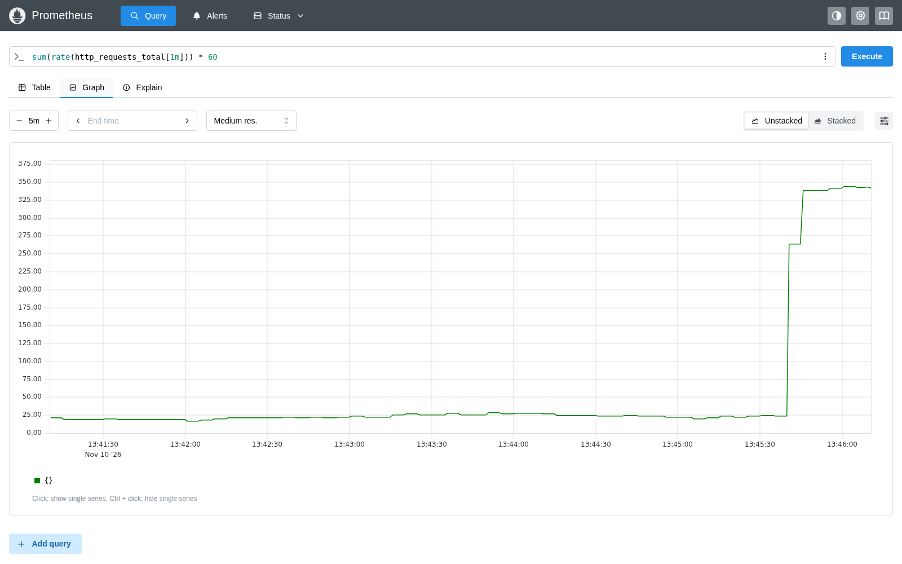
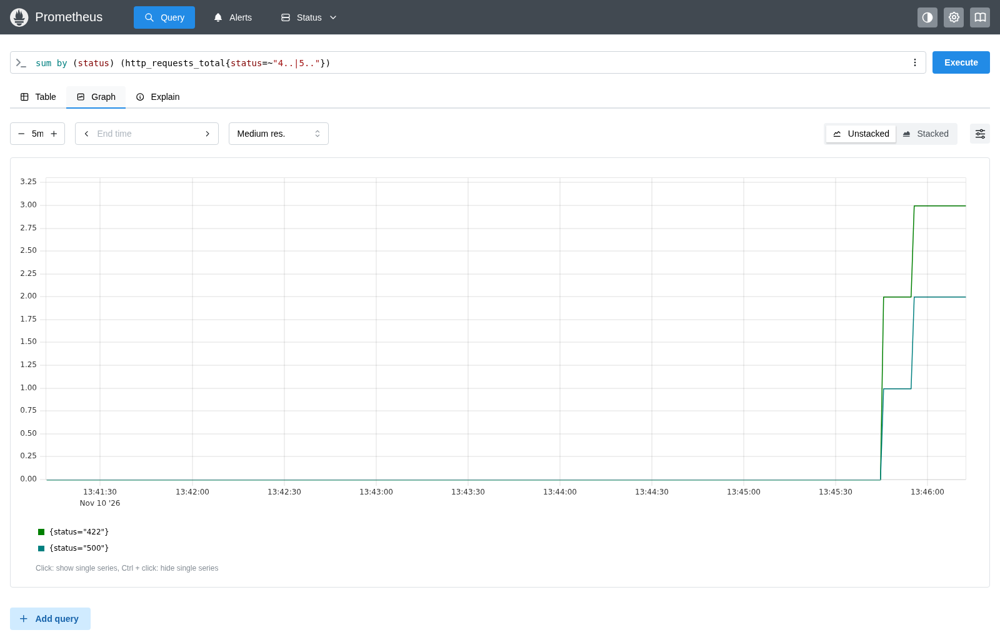
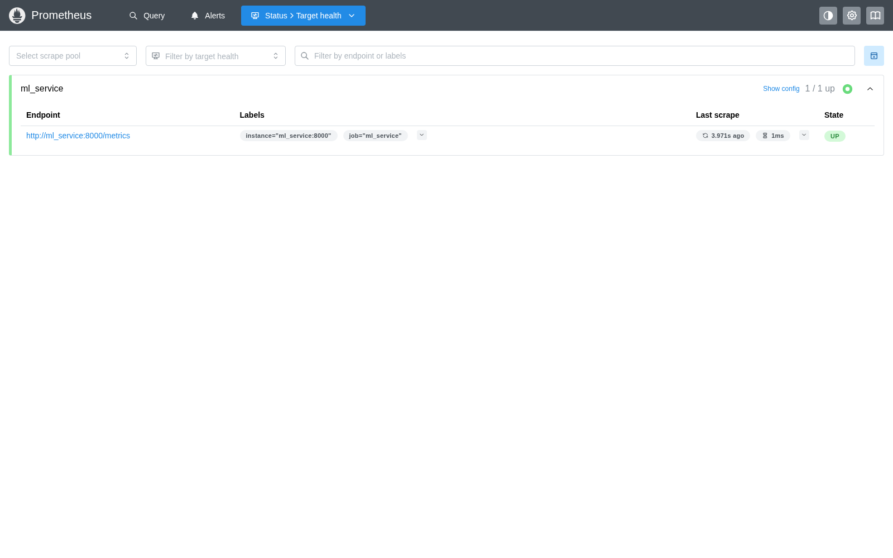
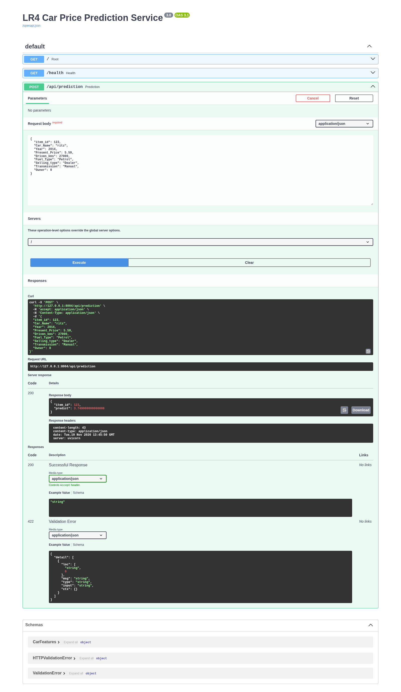
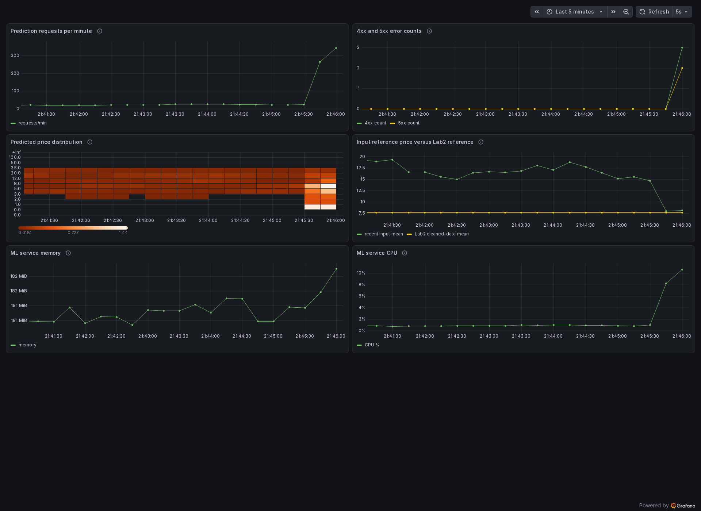

# Лабораторная работа №4. Car Price Prediction Monitoring

## Описание проекта

В работе сервис прогнозирования стоимости автомобиля из ЛР3 дополнен
автоматической отправкой запросов, метриками Prometheus и дашбордом Grafana.
Четыре сервиса запускаются совместно через Docker Compose.

Использованы Python 3.11, FastAPI, Pydantic, Uvicorn, pandas, NumPy,
scikit-learn, httpx, prometheus-client, Docker, Prometheus и Grafana.
Модель получена из MLflow ЛР2 и включена в репозиторий.

Предыдущие работы доступны в отдельных репозиториях
[ЛР1](https://github.com/Webber-Escaper/lab1_car_price),
[ЛР2](https://github.com/Webber-Escaper/lab2-car-price) и
[ЛР3](https://github.com/Webber-Escaper/lab3-car-price).

Для загрузки проекта выполните следующие команды.

```bash
git clone https://github.com/Webber-Escaper/lab4-car-price.git
cd lab4-car-price
```

Каталоги `data/`, `eda/` и `research/` сохраняют структуру предыдущих этапов.
Каталог `services/` содержит реализацию ЛР4.

## Структура проекта

```text
data/                          # Источник данных и правила получения файлов
eda/                           # Материалы разведочного анализа ЛР1
research/                      # Материалы экспериментов ЛР2
screenshots/                   # Скриншоты работающей системы
services/
├── ml_service/
│   ├── main.py                # Входные данные, endpoints и метрики
│   ├── api_handler.py         # Загрузка модели и подготовка признаков
│   ├── requirements.txt
│   ├── Dockerfile
│   ├── sample_request.json
│   ├── smoke_test.py          # HTTP-проверки и тестовые ошибки
│   └── static/                # Локальные файлы Swagger UI и лицензия
├── requests/
│   ├── requests.py            # Случайные запросы с интервалом 0–5 секунд
│   ├── requirements.txt       # Только httpx
│   └── Dockerfile
├── models/
│   ├── model.pkl
│   ├── model_meta.json
│   └── reference_data.json    # Средняя входная цена в очищенных данных ЛР2
├── prometheus/
│   └── prometheus.yml
├── grafana/
│   ├── provisioning/          # Подключение Prometheus и загрузка дашборда
│   └── dashboards/
│       └── lab4-dashboard.json
├── compose_requests.yml       # Этап с сервисом ЛР3 и генератором запросов
└── compose.yml                # Итоговый проект из четырех сервисов
run_lab4.sh
check_lab4.sh
stop_lab4.sh
requirements.txt
.gitignore
```

## Запуск проекта

Для запуска нужны Docker Engine и Docker Compose. Для проверочного скрипта
используется Python 3 из Ubuntu. Из корня клонированного проекта выполните
следующие команды.

```bash
bash run_lab4.sh
bash check_lab4.sh
```

Эквивалентная команда запуска Compose имеет следующий вид.

```bash
docker compose -f services/compose.yml up -d --build
```

Оба Python-сервиса собираются из публичного образа `python:3.11-slim`.
Prometheus и Grafana используют официальные образы. Первичная сборка требует
доступа к Docker Hub и PyPI. Модель уже сохранена в репозитории.

| Интерфейс | Адрес на машине запуска |
|---|---|
| Swagger UI | http://127.0.0.1:8004/docs |
| Метрики ML-сервиса | http://127.0.0.1:8004/metrics |
| Prometheus | http://127.0.0.1:9094 |
| Prometheus targets | http://127.0.0.1:9094/targets |
| Grafana dashboard | http://127.0.0.1:3004/d/lab4-car-price-monitoring |

Учебный логин и пароль Grafana — `admin` и `admin`.
Swagger UI загружает JavaScript и CSS из локального каталога `static/`.

В контейнерах используются внутренние адреса `ml_service:8000` и
`prometheus:9090`. Порты 8004, 9094 и 3004 опубликованы на хосте.
Каталог модели подключен к `/models` в режиме чтения. История Prometheus
и состояние Grafana хранятся в отдельных именованных Docker volumes.

## Модель и запрос

В `services/models/model.pkl` сохранен Pipeline с `RandomForestRegressor`.

- Имя модели `car_price_prediction_model`.
- Версия реестра MLflow `8`.
- Run ID `d08993c2115c4f13a49341e1720e0351`.
- Число очищенных объектов `286`, число признаков `9`.
- SHA-256 `08dad9ea8e8bed24e4279c3f95d6a3195dc29844cf245e5fd39f732c8aec8263`.

Модель загружается при старте приложения. Поле `item_id` и характеристики
автомобиля передаются одним объектом `CarFeatures`. Перед прогнозированием
номер исключается методом `model_dump(exclude={"item_id"})`.
При отсутствии `Car_Age` обработчик вычисляет `2018 - Year`, как в ЛР1.

```bash
curl -X POST http://127.0.0.1:8004/api/prediction \
  -H 'Content-Type: application/json' \
  --data-binary @services/ml_service/sample_request.json
```

Пример запроса имеет следующий вид.

```json
{
  "item_id": 123,
  "Car_Name": "ritz",
  "Year": 2014,
  "Present_Price": 5.59,
  "Driven_kms": 27000,
  "Fuel_Type": "Petrol",
  "Selling_type": "Dealer",
  "Transmission": "Manual",
  "Owner": 0
}
```

Для включенной модели результат имеет следующий вид с возможным различием
в последних знаках числа с плавающей точкой.

```json
{"item_id": 123, "predict": 3.749000000000009}
```

Материалы `research/` сохраняют результаты более ранних запусков ЛР2.
Источник используемой версии 8 указан отдельно в `model_meta.json`.
В `reference_data.json` записана средняя `Present_Price` по всем 286
очищенным объектам, равная примерно 7.6400, и SHA-256 исходного файла.

## Генератор запросов

Для каждого запроса `requests.py` заново формирует словарь автомобиля.
Название случайно выбирается из `ritz`, `ciaz`, `swift`, `fortuner`.
Также генерируются год, цена, пробег и категориальные признаки.
После запроса программа ожидает случайное время от 0 до 5 секунд.
В лог выводятся входные данные, статус HTTP и результат.

```bash
docker compose -f services/compose.yml logs -f --tail=10 requests
```

Ctrl+C завершает просмотр логов. Остановить генератор можно отдельной командой.

```bash
docker compose -f services/compose.yml stop requests
```

Сгенерированные записи используются как синтетические входы для проверки
сервиса и изменения графиков. Внешние зависимости генератора ограничены httpx.

Для локального запуска активируйте Python-окружение с httpx и выполните
следующую команду.

```bash
ML_SERVICE_URL=http://127.0.0.1:8004/api/prediction python services/requests/requests.py
```

### Этап с сервисом ЛР3, пункты 1–7

Сначала подготовьте образ ЛР3 в соседнем каталоге.

```bash
git clone https://github.com/Webber-Escaper/lab3-car-price.git ../lab3-car-price
docker build -t car_price_prediction:1 ../lab3-car-price/services/ml_service
```

Остановите итоговый проект, если он запущен, и выполните двухсервисный этап.

```bash
bash stop_lab4.sh
docker compose -f services/compose_requests.yml up -d --build
docker compose -f services/compose_requests.yml logs --tail=10 requests
```

Для перехода к итоговому проекту используйте следующий порядок.

```bash
docker compose -f services/compose_requests.yml down
bash run_lab4.sh
```

## Prometheus и проверка ошибок, пункты 8–14

Сервис предоставляет `/metrics`. Prometheus обращается к нему каждые
5 секунд. На странице `/targets` задача `ml_service` должна показывать `UP`.
Счетчик `http_requests_total` учитывает обращения к prediction API по
статусу ответа, включая ошибки проверки входа. Успешные прогнозы записываются
в Histogram `model_prediction_value`.

Границы корзин равны 0, 1, 2, 3, 5, 8, 12, 20, 35, 50 и 100.
Автоматически добавляется корзина с верхней границей `+Inf`.
Границы используют единицы цены из исходного датасета.
Значения `_bucket` накопительные. `_count` хранит число прогнозов,
а `_sum` хранит сумму прогнозируемых цен.

Запрос для корзин гистограммы имеет следующий вид.

```promql
model_prediction_value_bucket
```



Частота обращений к API в минуту вычисляется следующей формулой.

```promql
sum(rate(http_requests_total[1m])) * 60
```



Для совместного графика наблюдаемых ошибок 422 и 500 используется запрос.

```promql
sum by (status) (http_requests_total{status=~"4..|5.."})
```





Для ручной проверки в Swagger удалите обязательное поле `Present_Price`.
Сервис вернет 422. Для демонстрации ошибки вычисления задайте этому полю
конечное экстремальное значение `1e308`. В текущей модели оно превышает
поддерживаемый числовой диапазон и вызывает 500. После проверки отправьте
обычный запрос и убедитесь, что он снова обработан успешно.

Проверки HTTP можно выполнить из корня проекта.

```bash
python3 services/ml_service/smoke_test.py
```

Скрипт создает нормальные запросы, ошибки 422 и 500, затем проверяет
нормальный запрос после ошибки. Для проверки другого адреса используется
переменная окружения `LAB4_BASE_URL`.



## Дашборд Grafana, пункты 22–27

Prometheus datasource и дашборд загружаются из файлов provisioning при
старте Grafana. В дашборде представлены шесть графиков.

| График | Уровень и содержание |
|---|---|
| Prediction requests per minute | Прикладной. Частота запросов к prediction API |
| 4xx and 5xx error counts | Прикладной. Две линии накопленных ошибок 4xx и 5xx |
| Predicted price distribution | Выход модели. Распределение прогнозируемых цен во времени |
| Input reference price versus Lab2 reference | Вход модели. Средняя цена последних успешных запросов за минуту и средняя очищенных данных ЛР2 |
| ML service memory | Инфраструктурный. Резидентная память Python-процесса |
| ML service CPU | Инфраструктурный. Использование CPU процессом относительно одного ядра |

Сравнение средней входной цены с исходными данными показывает один аспект
изменения входов. Другие изменения распределения могут потребовать отдельных
проверок. Оценка точности прогнозов требует известных реальных цен продажи.



Файл `services/grafana/dashboards/lab4-dashboard.json` сохранен в репозитории
и используется при автоматической загрузке дашборда.

## Необязательный раздел БД

Методические указания относят PostgreSQL, pgAdmin, таблицы входных данных
и прогнозов к необязательному разделу. В этой работе используется вариант
из четырех сервисов. Мониторинг получает данные непосредственно из Prometheus.

## Остановка

```bash
bash stop_lab4.sh
```

Скрипт выполняет `docker compose down`. Именованные volumes сохраняют
накопленную историю. При повторном старте ML-процесса его локальные счетчики
начинаются с нуля.

## Версии образов и файлы окружения

ЛР3 использовала `car_price_prediction:1`. Первая реализация ЛР4 использовала
версию 2, текущая реализация сохранена как `car_price_prediction:3`.
Генератор использует `car_price_requests:2`. Команды сборки и запуска
также записаны комментариями в Dockerfiles.

Корневой `requirements.txt` объединяет зависимости двух Python-сервисов.
В requirements генератора указан только httpx. В `.gitignore` исключены
окружения, кэши, исходные данные, локальные базы, логи и файлы `.env`.
Готовая модель включена отдельным исключением.

Локальные файлы Swagger UI сопровождаются исходными URL, SHA-256 и
лицензией Apache-2.0 в каталоге `static/`.
